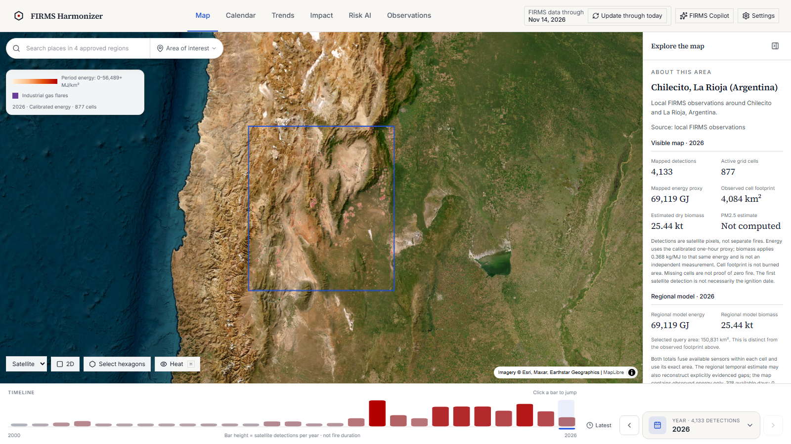

<!-- _paginate: false -->

# Project Almenara

Restoring 26 years of NASA satellite fire memory

26 years of continuous record · 2000–2026

MODIS2000 · 1 km pixel

VIIRS2012 · 375 m pixel

One comparable fire series across two satellite generations: harmonized, audited and explained.

▶ <a href="http://localhost:5173/">Open the live demo · FIRMS Harmonizer</a>

Live app: map, calendar, trends, impact, risk and FIRMS Copilot over the real cube.

---

## Mathematical Rigor & Scientific Method

We state a falsifiable hypothesis, fix the pass thresholds first, and publish failures too

<b class="n">H₀</b>
<b>Hypothesis.</b> The 2012 jump is instrumental (VIIRS resolution), not climatic. If we are right, the harmonized series shows no structural break in 2012.

* **Thresholds fixed before looking at results:** Chow break test p > 0.10 and Wasserstein-1 reduction ≥ 88 %.
* **Same code, four real regions:** Chilecito (AR), Iberia (ES/PT), Manaus (BR), Orlando (US).
* **Uncertainty, not guesses:** RTS Kalman smoother with Joseph-stabilized covariance and 95 % intervals.
* **Gaps only with evidence:** a missing day is never filled unless an outage or cloud mask proves it.
* **Reproducible:** 720 automated backend tests and a validation report anyone can rerun.

### The tests behind the verdict

$$F_{\text{Chow}}=\frac{\big(\text{RSS}_{p}-(\text{RSS}_1+\text{RSS}_2)\big)/k}{(\text{RSS}_1+\text{RSS}_2)/(N_1+N_2-2k)}$$

$$W_1(F_{\text{pre}},F_{\text{post}})=\int_{-\infty}^{\infty}\lvert F_{\text{pre}}(x)-F_{\text{post}}(x)\rvert\,dx$$

$$P_{t|t}=(1-K h)^2P_{t|t-1}+K^2R$$

What we do <u>not</u> claim

- Detections are satellite pixels, not individual fires.
- No reconstruction without explicit gap evidence.
- Burned-area R² is descriptive, not out-of-sample validation.
- PM2.5 is shown only when emission inputs exist.

---

## The 400% Illusion: Resolution vs. Reality

Without harmonization, a decade of fire history is not comparable

■ MODIS &nbsp; ■ VIIRS &nbsp; raw detections per year · our 4 regions · hover a bar

<svg class="chart" viewBox="0 0 1000 350" role="img" aria-label="Raw satellite detections per year"><line x1="60" x2="990" y1="290.0" y2="290.0" class="grid"/><text x="52" y="295.0" class="ax" text-anchor="end">0k</text><line x1="60" x2="990" y1="222.5" y2="222.5" class="grid"/><text x="52" y="227.5" class="ax" text-anchor="end">50k</text><line x1="60" x2="990" y1="155.0" y2="155.0" class="grid"/><text x="52" y="160.0" class="ax" text-anchor="end">100k</text><line x1="60" x2="990" y1="87.5" y2="87.5" class="grid"/><text x="52" y="92.5" class="ax" text-anchor="end">150k</text><g class="bar partial"><title>2000 (partial year): MODIS 266 · VIIRS 0 · total 266</title><rect x="63.0" y="289.6" width="28.4" height="0.4" class="modis"/><rect x="63.0" y="289.6" width="28.4" height="0.0" class="viirs"/></g><text x="77.2" y="310" class="ax" text-anchor="middle">2000</text><g class="bar"><title>2001: MODIS 6,146 · VIIRS 0 · total 6,146</title><rect x="97.4" y="281.7" width="28.4" height="8.3" class="modis"/><rect x="97.4" y="281.7" width="28.4" height="0.0" class="viirs"/></g><g class="bar"><title>2002: MODIS 12,641 · VIIRS 0 · total 12,641</title><rect x="131.9" y="272.9" width="28.4" height="17.1" class="modis"/><rect x="131.9" y="272.9" width="28.4" height="0.0" class="viirs"/></g><g class="bar"><title>2003: MODIS 18,596 · VIIRS 0 · total 18,596</title><rect x="166.3" y="264.9" width="28.4" height="25.1" class="modis"/><rect x="166.3" y="264.9" width="28.4" height="0.0" class="viirs"/></g><g class="bar"><title>2004: MODIS 14,778 · VIIRS 0 · total 14,778</title><rect x="200.8" y="270.0" width="28.4" height="20.0" class="modis"/><rect x="200.8" y="270.0" width="28.4" height="0.0" class="viirs"/></g><text x="215.0" y="310" class="ax" text-anchor="middle">2004</text><g class="bar"><title>2005: MODIS 20,308 · VIIRS 0 · total 20,308</title><rect x="235.2" y="262.6" width="28.4" height="27.4" class="modis"/><rect x="235.2" y="262.6" width="28.4" height="0.0" class="viirs"/></g><g class="bar"><title>2006: MODIS 14,208 · VIIRS 0 · total 14,208</title><rect x="269.7" y="270.8" width="28.4" height="19.2" class="modis"/><rect x="269.7" y="270.8" width="28.4" height="0.0" class="viirs"/></g><g class="bar"><title>2007: MODIS 10,612 · VIIRS 0 · total 10,612</title><rect x="304.1" y="275.7" width="28.4" height="14.3" class="modis"/><rect x="304.1" y="275.7" width="28.4" height="0.0" class="viirs"/></g><g class="bar"><title>2008: MODIS 6,980 · VIIRS 0 · total 6,980</title><rect x="338.6" y="280.6" width="28.4" height="9.4" class="modis"/><rect x="338.6" y="280.6" width="28.4" height="0.0" class="viirs"/></g><text x="352.8" y="310" class="ax" text-anchor="middle">2008</text><g class="bar"><title>2009: MODIS 14,440 · VIIRS 0 · total 14,440</title><rect x="373.0" y="270.5" width="28.4" height="19.5" class="modis"/><rect x="373.0" y="270.5" width="28.4" height="0.0" class="viirs"/></g><g class="bar"><title>2010: MODIS 10,741 · VIIRS 0 · total 10,741</title><rect x="407.4" y="275.5" width="28.4" height="14.5" class="modis"/><rect x="407.4" y="275.5" width="28.4" height="0.0" class="viirs"/></g><g class="bar"><title>2011: MODIS 11,336 · VIIRS 0 · total 11,336</title><rect x="441.9" y="274.7" width="28.4" height="15.3" class="modis"/><rect x="441.9" y="274.7" width="28.4" height="0.0" class="viirs"/></g><g class="bar"><title>2012: MODIS 15,544 · VIIRS 51,267 · total 66,811</title><rect x="476.3" y="269.0" width="28.4" height="21.0" class="modis"/><rect x="476.3" y="199.8" width="28.4" height="69.2" class="viirs"/></g><text x="490.6" y="310" class="ax" text-anchor="middle">2012</text><g class="bar"><title>2013: MODIS 10,843 · VIIRS 39,267 · total 50,110</title><rect x="510.8" y="275.4" width="28.4" height="14.6" class="modis"/><rect x="510.8" y="222.4" width="28.4" height="53.0" class="viirs"/></g><g class="bar"><title>2014: MODIS 7,434 · VIIRS 32,191 · total 39,625</title><rect x="545.2" y="280.0" width="28.4" height="10.0" class="modis"/><rect x="545.2" y="236.5" width="28.4" height="43.5" class="viirs"/></g><g class="bar"><title>2015: MODIS 11,169 · VIIRS 48,379 · total 59,548</title><rect x="579.7" y="274.9" width="28.4" height="15.1" class="modis"/><rect x="579.7" y="209.6" width="28.4" height="65.3" class="viirs"/></g><g class="bar"><title>2016: MODIS 11,513 · VIIRS 43,471 · total 54,984</title><rect x="614.1" y="274.5" width="28.4" height="15.5" class="modis"/><rect x="614.1" y="215.8" width="28.4" height="58.7" class="viirs"/></g><text x="628.3" y="310" class="ax" text-anchor="middle">2016</text><g class="bar"><title>2017: MODIS 17,097 · VIIRS 62,733 · total 79,830</title><rect x="648.6" y="266.9" width="28.4" height="23.1" class="modis"/><rect x="648.6" y="182.2" width="28.4" height="84.7" class="viirs"/></g><g class="bar"><title>2018: MODIS 6,386 · VIIRS 55,145 · total 61,531</title><rect x="683.0" y="281.4" width="28.4" height="8.6" class="modis"/><rect x="683.0" y="206.9" width="28.4" height="74.4" class="viirs"/></g><g class="bar"><title>2019: MODIS 8,102 · VIIRS 66,113 · total 74,215</title><rect x="717.4" y="279.1" width="28.4" height="10.9" class="modis"/><rect x="717.4" y="189.8" width="28.4" height="89.3" class="viirs"/></g><g class="bar"><title>2020: MODIS 8,462 · VIIRS 67,125 · total 75,587</title><rect x="751.9" y="278.6" width="28.4" height="11.4" class="modis"/><rect x="751.9" y="188.0" width="28.4" height="90.6" class="viirs"/></g><text x="766.1" y="310" class="ax" text-anchor="middle">2020</text><g class="bar"><title>2021: MODIS 7,625 · VIIRS 59,977 · total 67,602</title><rect x="786.3" y="279.7" width="28.4" height="10.3" class="modis"/><rect x="786.3" y="198.7" width="28.4" height="81.0" class="viirs"/></g><g class="bar"><title>2022: MODIS 12,220 · VIIRS 86,882 · total 99,102</title><rect x="820.8" y="273.5" width="28.4" height="16.5" class="modis"/><rect x="820.8" y="156.2" width="28.4" height="117.3" class="viirs"/></g><g class="bar"><title>2023: MODIS 10,549 · VIIRS 132,982 · total 143,531</title><rect x="855.2" y="275.8" width="28.4" height="14.2" class="modis"/><rect x="855.2" y="96.2" width="28.4" height="179.5" class="viirs"/></g><g class="bar"><title>2024: MODIS 9,346 · VIIRS 118,247 · total 127,593</title><rect x="889.7" y="277.4" width="28.4" height="12.6" class="modis"/><rect x="889.7" y="117.7" width="28.4" height="159.6" class="viirs"/></g><text x="903.9" y="310" class="ax" text-anchor="middle">2024</text><g class="bar"><title>2025: MODIS 16,069 · VIIRS 157,459 · total 173,528</title><rect x="924.1" y="268.3" width="28.4" height="21.7" class="modis"/><rect x="924.1" y="55.7" width="28.4" height="212.6" class="viirs"/></g><g class="bar partial"><title>2026 (partial year): MODIS 13,405 · VIIRS 157,374 · total 170,779</title><rect x="958.6" y="271.9" width="28.4" height="18.1" class="modis"/><rect x="958.6" y="59.4" width="28.4" height="212.5" class="viirs"/></g><text x="972.8" y="310" class="ax" text-anchor="middle">2026</text><line x1="473.3" x2="473.3" y1="20" y2="290" class="cut"/><text x="465.3" y="36" class="cutlbl" text-anchor="end">VIIRS joins · Jan 2012</text></svg>

+489%

Raw detections from 2011 to 2012: <b>11,336 → 66,811</b>. The fires did not change; the sensor did.

* VIIRS pixels are **375 m**: one MODIS 1 km pixel holds ~7 of them.
* In 2012 VIIRS saw **3.3×** more detections than MODIS over the same places and days.
* Counting pixels blindly turns a sensor upgrade into a fake fire trend.

---

## Our Solution in Four Steps

From scattered points to one clean, comparable historical series · click a step for its math

01

### Hexagon grid
Points spread over a common H3 area.

H3 quadrature · PSF footprint

Math

Each detection's elliptical PSF is spread over its H3 r7 cell (5.16 km²) and 6 neighbours: $w_j\propto e^{-\frac12 d_j^\top\Sigma_k^{-1}d_j}$.

02

### Noise filter
Drops always-on industrial heat (flares, plants).

Shannon temporal entropy

Math

$H_{\text{temp}}=-\frac{1}{\ln 12}\sum_m p_m\ln p_m$. Year-round sources ($H>0.75$) are industrial, not seasonal fires.

03

### Sensor harmonization
Corrects the VIIRS sensitivity jump.

EQM quantile mapping + GPD tail

Math

$\hat X_V=F_M^{-1}(F_V(X_V))+\Delta E_{\text{sub}}$, per biome and scan angle; $\Delta E_{\text{sub}}$ adds the energy MODIS misses below 8 MW, from a Generalized Pareto tail.

04

### Sampling gaps
Estimates clouds and outages with honest uncertainty.

RTS Kalman + 95 % CI

Math

When every sensor is blind, a cross-sensor historical prior ($R=40$) keeps the state alive; bands widen instead of inventing data.

* **Common hexagonal H3 area** → every sensor is measured on the same ground.
* **No industrial heat, no VIIRS jump** → trends reflect fires, not hardware.
* **Gaps carry uncertainty** → the chart shows what we know and how well.

---

## Statistical Audit: Measured, Not Promised

Real cube, rerun on 15 Nov 2026 · same code as the live demo's audit panel

| Region | Chow p · raw → harmonized | 2012 gate | W₁ reduction |
|---|---|---|---|
| Iberia (ES/PT) | 0.083 → **0.57** | PASS | 86.7 % |
| Chilecito (AR) | 0.034 → **0.31** | PASS | 85.4 % |
| Manaus (BR) | 0.38 → **0.46** | PASS* | 42.6 % |
| Orlando (US) | 1.7·10⁻⁷ → **0.005** | FAIL | 72.2 % |

How to read this

- Chow p > 0.10 means no structural break at January 2012: the series is continuous.
- \*Manaus raw data showed no break either, so its pass is not evidence of correction.
- W₁ measures how different the pre-/post-2012 distributions are; none reaches our 88 % target yet.
- Orlando's break shrinks by five orders of magnitude but remains: we report it instead of hiding it.

3 / 4

regions pass the 2012 continuity gate after harmonization

43–87%

less cross-era divergence (Wasserstein-1)

▶ <a href="http://localhost:5173/">Interactive demo: FIRMS Harmonizer (2000–2026)</a> &nbsp;·&nbsp; Live H3 map · Calendar · Risk & Impact · FIRMS Copilot

