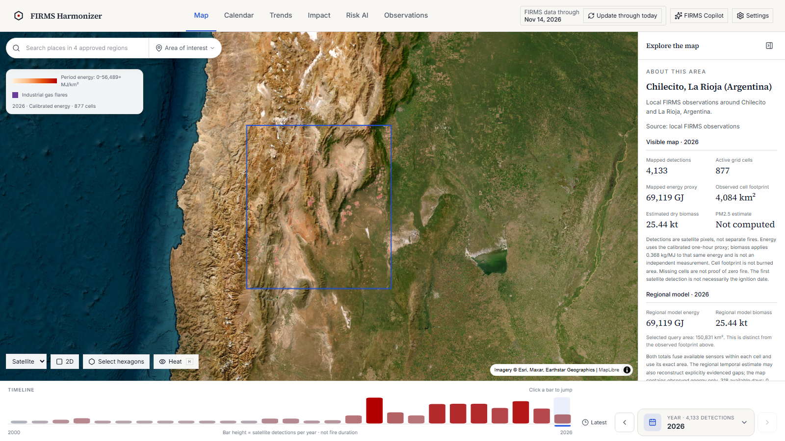

<!-- _paginate: false -->

# Project Almenara

Restaurando 26 años de memoria satelital de incendios de la NASA

26 años de registro continuo · 2000–2026

MODIS2000 · píxel de 1 km

VIIRS2012 · píxel de 375 m

Una serie de incendios comparable entre dos generaciones de satélites: armonizada, auditada y explicada.

▶ <a href="http://localhost:5173/">Abrir la demo en vivo · FIRMS Harmonizer</a>

App en vivo: mapa, calendario, tendencias, impacto, riesgo y FIRMS Copilot sobre el cubo real.

---

## Rigor matemático y método científico

Planteamos una hipótesis falsable, fijamos los umbrales antes de medir y publicamos también los fallos

<b class="n">H₀</b>
<b>Hipótesis.</b> El salto de 2012 es instrumental (resolución de VIIRS), no climático. Si acertamos, la serie armonizada no muestra ruptura estructural en 2012.

* **Umbrales fijados antes de ver resultados:** test de ruptura de Chow p > 0,10 y reducción de Wasserstein-1 ≥ 88 %.
* **Mismo código, cuatro regiones reales:** Chilecito (AR), Iberia (ES/PT), Manaos (BR), Orlando (EE. UU.).
* **Incertidumbre, no conjeturas:** suavizador RTS Kalman con covarianza estabilizada (Joseph) e intervalos del 95 %.
* **Huecos solo con evidencia:** un día sin datos nunca se rellena salvo que una caída de sensor o una máscara de nubes lo justifique.
* **Reproducible:** 720 tests automáticos en el backend y un informe de validación que cualquiera puede volver a ejecutar.

### Los tests detrás del veredicto

$$F_{\text{Chow}}=\frac{\big(\text{RSS}_{p}-(\text{RSS}_1+\text{RSS}_2)\big)/k}{(\text{RSS}_1+\text{RSS}_2)/(N_1+N_2-2k)}$$

$$W_1(F_{\text{pre}},F_{\text{post}})=\int_{-\infty}^{\infty}\lvert F_{\text{pre}}(x)-F_{\text{post}}(x)\rvert\,dx$$

$$P_{t|t}=(1-K h)^2P_{t|t-1}+K^2R$$

Lo que <u>no</u> afirmamos

- Las detecciones son píxeles de satélite, no incendios individuales.
- No reconstruimos sin evidencia explícita de hueco.
- El R² frente a área quemada es descriptivo, no una validación fuera de muestra.
- El PM2.5 solo se muestra cuando existen datos de emisión.

---

## La ilusión del 400 %: resolución frente a realidad

Sin armonización, una década de historia de incendios no es comparable

■ MODIS &nbsp; ■ VIIRS &nbsp; detecciones crudas por año · nuestras 4 regiones · pasa el ratón por una barra

<svg class="chart" viewBox="0 0 1000 350" role="img" aria-label="Detecciones satelitales crudas por año"><line x1="60" x2="990" y1="290.0" y2="290.0" class="grid"/><text x="52" y="295.0" class="ax" text-anchor="end">0k</text><line x1="60" x2="990" y1="222.5" y2="222.5" class="grid"/><text x="52" y="227.5" class="ax" text-anchor="end">50k</text><line x1="60" x2="990" y1="155.0" y2="155.0" class="grid"/><text x="52" y="160.0" class="ax" text-anchor="end">100k</text><line x1="60" x2="990" y1="87.5" y2="87.5" class="grid"/><text x="52" y="92.5" class="ax" text-anchor="end">150k</text><g class="bar partial"><title>2000 (año parcial): MODIS 266 · VIIRS 0 · total 266</title><rect x="63.0" y="289.6" width="28.4" height="0.4" class="modis"/><rect x="63.0" y="289.6" width="28.4" height="0.0" class="viirs"/></g><text x="77.2" y="310" class="ax" text-anchor="middle">2000</text><g class="bar"><title>2001: MODIS 6.146 · VIIRS 0 · total 6.146</title><rect x="97.4" y="281.7" width="28.4" height="8.3" class="modis"/><rect x="97.4" y="281.7" width="28.4" height="0.0" class="viirs"/></g><g class="bar"><title>2002: MODIS 12.641 · VIIRS 0 · total 12.641</title><rect x="131.9" y="272.9" width="28.4" height="17.1" class="modis"/><rect x="131.9" y="272.9" width="28.4" height="0.0" class="viirs"/></g><g class="bar"><title>2003: MODIS 18.596 · VIIRS 0 · total 18.596</title><rect x="166.3" y="264.9" width="28.4" height="25.1" class="modis"/><rect x="166.3" y="264.9" width="28.4" height="0.0" class="viirs"/></g><g class="bar"><title>2004: MODIS 14.778 · VIIRS 0 · total 14.778</title><rect x="200.8" y="270.0" width="28.4" height="20.0" class="modis"/><rect x="200.8" y="270.0" width="28.4" height="0.0" class="viirs"/></g><text x="215.0" y="310" class="ax" text-anchor="middle">2004</text><g class="bar"><title>2005: MODIS 20.308 · VIIRS 0 · total 20.308</title><rect x="235.2" y="262.6" width="28.4" height="27.4" class="modis"/><rect x="235.2" y="262.6" width="28.4" height="0.0" class="viirs"/></g><g class="bar"><title>2006: MODIS 14.208 · VIIRS 0 · total 14.208</title><rect x="269.7" y="270.8" width="28.4" height="19.2" class="modis"/><rect x="269.7" y="270.8" width="28.4" height="0.0" class="viirs"/></g><g class="bar"><title>2007: MODIS 10.612 · VIIRS 0 · total 10.612</title><rect x="304.1" y="275.7" width="28.4" height="14.3" class="modis"/><rect x="304.1" y="275.7" width="28.4" height="0.0" class="viirs"/></g><g class="bar"><title>2008: MODIS 6.980 · VIIRS 0 · total 6.980</title><rect x="338.6" y="280.6" width="28.4" height="9.4" class="modis"/><rect x="338.6" y="280.6" width="28.4" height="0.0" class="viirs"/></g><text x="352.8" y="310" class="ax" text-anchor="middle">2008</text><g class="bar"><title>2009: MODIS 14.440 · VIIRS 0 · total 14.440</title><rect x="373.0" y="270.5" width="28.4" height="19.5" class="modis"/><rect x="373.0" y="270.5" width="28.4" height="0.0" class="viirs"/></g><g class="bar"><title>2010: MODIS 10.741 · VIIRS 0 · total 10.741</title><rect x="407.4" y="275.5" width="28.4" height="14.5" class="modis"/><rect x="407.4" y="275.5" width="28.4" height="0.0" class="viirs"/></g><g class="bar"><title>2011: MODIS 11.336 · VIIRS 0 · total 11.336</title><rect x="441.9" y="274.7" width="28.4" height="15.3" class="modis"/><rect x="441.9" y="274.7" width="28.4" height="0.0" class="viirs"/></g><g class="bar"><title>2012: MODIS 15.544 · VIIRS 51.267 · total 66.811</title><rect x="476.3" y="269.0" width="28.4" height="21.0" class="modis"/><rect x="476.3" y="199.8" width="28.4" height="69.2" class="viirs"/></g><text x="490.6" y="310" class="ax" text-anchor="middle">2012</text><g class="bar"><title>2013: MODIS 10.843 · VIIRS 39.267 · total 50.110</title><rect x="510.8" y="275.4" width="28.4" height="14.6" class="modis"/><rect x="510.8" y="222.4" width="28.4" height="53.0" class="viirs"/></g><g class="bar"><title>2014: MODIS 7.434 · VIIRS 32.191 · total 39.625</title><rect x="545.2" y="280.0" width="28.4" height="10.0" class="modis"/><rect x="545.2" y="236.5" width="28.4" height="43.5" class="viirs"/></g><g class="bar"><title>2015: MODIS 11.169 · VIIRS 48.379 · total 59.548</title><rect x="579.7" y="274.9" width="28.4" height="15.1" class="modis"/><rect x="579.7" y="209.6" width="28.4" height="65.3" class="viirs"/></g><g class="bar"><title>2016: MODIS 11.513 · VIIRS 43.471 · total 54.984</title><rect x="614.1" y="274.5" width="28.4" height="15.5" class="modis"/><rect x="614.1" y="215.8" width="28.4" height="58.7" class="viirs"/></g><text x="628.3" y="310" class="ax" text-anchor="middle">2016</text><g class="bar"><title>2017: MODIS 17.097 · VIIRS 62.733 · total 79.830</title><rect x="648.6" y="266.9" width="28.4" height="23.1" class="modis"/><rect x="648.6" y="182.2" width="28.4" height="84.7" class="viirs"/></g><g class="bar"><title>2018: MODIS 6.386 · VIIRS 55.145 · total 61.531</title><rect x="683.0" y="281.4" width="28.4" height="8.6" class="modis"/><rect x="683.0" y="206.9" width="28.4" height="74.4" class="viirs"/></g><g class="bar"><title>2019: MODIS 8.102 · VIIRS 66.113 · total 74.215</title><rect x="717.4" y="279.1" width="28.4" height="10.9" class="modis"/><rect x="717.4" y="189.8" width="28.4" height="89.3" class="viirs"/></g><g class="bar"><title>2020: MODIS 8.462 · VIIRS 67.125 · total 75.587</title><rect x="751.9" y="278.6" width="28.4" height="11.4" class="modis"/><rect x="751.9" y="188.0" width="28.4" height="90.6" class="viirs"/></g><text x="766.1" y="310" class="ax" text-anchor="middle">2020</text><g class="bar"><title>2021: MODIS 7.625 · VIIRS 59.977 · total 67.602</title><rect x="786.3" y="279.7" width="28.4" height="10.3" class="modis"/><rect x="786.3" y="198.7" width="28.4" height="81.0" class="viirs"/></g><g class="bar"><title>2022: MODIS 12.220 · VIIRS 86.882 · total 99.102</title><rect x="820.8" y="273.5" width="28.4" height="16.5" class="modis"/><rect x="820.8" y="156.2" width="28.4" height="117.3" class="viirs"/></g><g class="bar"><title>2023: MODIS 10.549 · VIIRS 132.982 · total 143.531</title><rect x="855.2" y="275.8" width="28.4" height="14.2" class="modis"/><rect x="855.2" y="96.2" width="28.4" height="179.5" class="viirs"/></g><g class="bar"><title>2024: MODIS 9.346 · VIIRS 118.247 · total 127.593</title><rect x="889.7" y="277.4" width="28.4" height="12.6" class="modis"/><rect x="889.7" y="117.7" width="28.4" height="159.6" class="viirs"/></g><text x="903.9" y="310" class="ax" text-anchor="middle">2024</text><g class="bar"><title>2025: MODIS 16.069 · VIIRS 157.459 · total 173.528</title><rect x="924.1" y="268.3" width="28.4" height="21.7" class="modis"/><rect x="924.1" y="55.7" width="28.4" height="212.6" class="viirs"/></g><g class="bar partial"><title>2026 (año parcial): MODIS 13.405 · VIIRS 157.374 · total 170.779</title><rect x="958.6" y="271.9" width="28.4" height="18.1" class="modis"/><rect x="958.6" y="59.4" width="28.4" height="212.5" class="viirs"/></g><text x="972.8" y="310" class="ax" text-anchor="middle">2026</text><line x1="473.3" x2="473.3" y1="20" y2="290" class="cut"/><text x="465.3" y="36" class="cutlbl" text-anchor="end">Entra VIIRS · ene 2012</text></svg>

+489 %

Detecciones crudas de 2011 a 2012: <b>11.336 → 66.811</b>. Los incendios no cambiaron; cambió el sensor.

* Los píxeles de VIIRS miden **375 m**: en un píxel MODIS de 1 km caben unos 7.
* En 2012 VIIRS vio **3,3×** más detecciones que MODIS en los mismos lugares y días.
* Contar píxeles a ciegas convierte una mejora del sensor en una falsa tendencia de incendios.

---

## Nuestra solución en cuatro pasos

De puntos dispersos a una serie histórica limpia y comparable · haz clic en un paso para ver su matemática

01

### Malla de hexágonos
Puntos repartidos en un área H3 común.

Cuadratura H3 · huella PSF

Matemática

La PSF elíptica de cada detección se reparte entre su celda H3 r7 (5,16 km²) y sus 6 vecinas: $w_j\propto e^{-\frac12 d_j^\top\Sigma_k^{-1}d_j}$.

02

### Filtrado de ruido
Descarta el calor industrial permanente (antorchas, plantas).

Entropía temporal de Shannon

Matemática

$H_{\text{temp}}=-\frac{1}{\ln 12}\sum_m p_m\ln p_m$. Las fuentes activas todo el año ($H>0{,}75$) son industriales, no incendios estacionales.

03

### Armonización de sensores
Corrige el salto de sensibilidad de VIIRS.

Mapeo cuantílico EQM + cola GPD

Matemática

$\hat X_V=F_M^{-1}(F_V(X_V))+\Delta E_{\text{sub}}$, por bioma y ángulo de escaneo; $\Delta E_{\text{sub}}$ añade la energía que MODIS no ve por debajo de 8 MW, a partir de una cola de Pareto generalizada.

04

### Huecos de muestreo
Estima nubes y caídas de sensor con incertidumbre honesta.

RTS Kalman + IC 95 %

Matemática

Cuando todos los sensores están ciegos, un prior histórico entre sensores ($R=40$) mantiene vivo el estado; las bandas se ensanchan en lugar de inventar datos.

* **Área hexagonal H3 común** → todos los sensores se miden sobre el mismo terreno.
* **Sin calor industrial ni salto de VIIRS** → las tendencias reflejan incendios, no hardware.
* **Los huecos llevan incertidumbre** → el gráfico muestra qué sabemos y con qué precisión.

---

## Auditoría estadística: medida, no prometida

Cubo real, recalculado el 15 nov 2026 · el mismo código que el panel de auditoría de la demo

| Región | p de Chow · cruda → armonizada | Control 2012 | Reducción W₁ |
|---|---|---|---|
| Iberia (ES/PT) | 0,083 → **0,57** | APRUEBA | 86,7 % |
| Chilecito (AR) | 0,034 → **0,31** | APRUEBA | 85,4 % |
| Manaos (BR) | 0,38 → **0,46** | APRUEBA* | 42,6 % |
| Orlando (EE. UU.) | 1,7·10⁻⁷ → **0,005** | NO APRUEBA | 72,2 % |

Cómo leer esta tabla

- p de Chow > 0,10 significa que no hay ruptura estructural en enero de 2012: la serie es continua.
- \*Los datos crudos de Manaos tampoco mostraban ruptura, así que su aprobado no prueba la corrección.
- W₁ mide cuánto difieren las distribuciones antes y después de 2012; ninguna región alcanza aún nuestro objetivo del 88 %.
- La ruptura de Orlando se reduce cinco órdenes de magnitud pero persiste: la mostramos en lugar de ocultarla.

3 / 4

regiones superan el control de continuidad de 2012 tras la armonización

43–87 %

menos divergencia entre épocas (Wasserstein-1)

▶ <a href="http://localhost:5173/">Demo interactiva: FIRMS Harmonizer (2000–2026)</a> &nbsp;·&nbsp; Mapa H3 en vivo · Calendario · Riesgo e impacto · FIRMS Copilot

