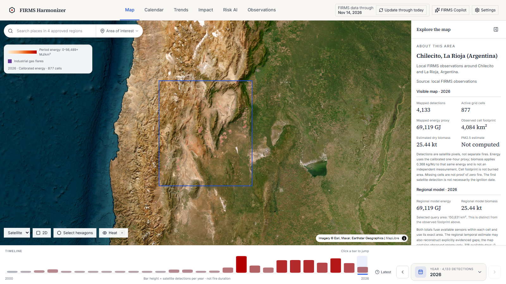

<!-- _paginate: false -->

# Project Almenara

Restoring 26 years of NASA satellite fire memory

26 years of continuous record · 2000–2026

MODIS2000 · 1 km pixel

VIIRS2012 · 375 m pixel

One comparable fire series across two satellite generations: harmonized, audited and explained.

▶ <a href="http://localhost:5173/">Open the live demo · FIRMS Harmonizer</a>

Live app: map, calendar, trends, impact, risk and FIRMS Copilot over the real cube.

---

## Mathematical Rigor & Scientific Method

We state a falsifiable hypothesis, fix the pass thresholds first, and publish failures too

<b class="n">H₀</b>
<b>Hypothesis.</b> The 2012 jump is instrumental (VIIRS resolution), not climatic. If we are right, the harmonized series shows no structural break in 2012.

* **Thresholds fixed before looking at results:** Chow break test p > 0.10 and Wasserstein-1 reduction ≥ 88 %.
* **Same code, four real regions:** Chilecito (AR), Iberia (ES/PT), Manaus (BR), Orlando (US).
* **Uncertainty, not guesses:** RTS Kalman smoother with Joseph-stabilized covariance and 95 % intervals.
* **Gaps only with evidence:** a missing day is never filled unless an outage or cloud mask proves it.
* **Reproducible:** 720 automated backend tests and a validation report anyone can rerun.

### The tests behind the verdict

$$F_{\text{Chow}}=\frac{\big(\text{RSS}_{p}-(\text{RSS}_1+\text{RSS}_2)\big)/k}{(\text{RSS}_1+\text{RSS}_2)/(N_1+N_2-2k)}$$

$$W_1(F_{\text{pre}},F_{\text{post}})=\int_{-\infty}^{\infty}\lvert F_{\text{pre}}(x)-F_{\text{post}}(x)\rvert\,dx$$

$$P_{t|t}=(1-K h)^2P_{t|t-1}+K^2R$$

What we do <u>not</u> claim

- Detections are satellite pixels, not individual fires.
- No reconstruction without explicit gap evidence.
- Burned-area R² is descriptive, not out-of-sample validation.
- PM2.5 is shown only when emission inputs exist.

---

## The 400% Illusion: Resolution vs. Reality

Without harmonization, a decade of fire history is not comparable

■ MODIS &nbsp; ■ VIIRS &nbsp; raw detections per year · our 4 regions · hover a bar

{{CHART}}

{{JUMP}}%

Raw detections from 2011 to 2012: <b>{{T2011}} → {{T2012}}</b>. The fires did not change; the sensor did.

* VIIRS pixels are **375 m**: one MODIS 1 km pixel holds ~7 of them.
* In 2012 VIIRS saw **{{RATIO}}×** more detections than MODIS over the same places and days.
* Counting pixels blindly turns a sensor upgrade into a fake fire trend.

---

## Our Solution in Four Steps

From scattered points to one clean, comparable historical series · click a step for its math

01

### Hexagon grid
Points spread over a common H3 area.

H3 quadrature · PSF footprint

Math

Each detection's elliptical PSF is spread over its H3 r7 cell (5.16 km²) and 6 neighbours: $w_j\propto e^{-\frac12 d_j^\top\Sigma_k^{-1}d_j}$.

02

### Noise filter
Drops always-on industrial heat (flares, plants).

Shannon temporal entropy

Math

$H_{\text{temp}}=-\frac{1}{\ln 12}\sum_m p_m\ln p_m$. Year-round sources ($H>0.75$) are industrial, not seasonal fires.

03

### Sensor harmonization
Corrects the VIIRS sensitivity jump.

EQM quantile mapping + GPD tail

Math

$\hat X_V=F_M^{-1}(F_V(X_V))+\Delta E_{\text{sub}}$, per biome and scan angle; $\Delta E_{\text{sub}}$ adds the energy MODIS misses below 8 MW, from a Generalized Pareto tail.

04

### Sampling gaps
Estimates clouds and outages with honest uncertainty.

RTS Kalman + 95 % CI

Math

When every sensor is blind, a cross-sensor historical prior ($R=40$) keeps the state alive; bands widen instead of inventing data.

* **Common hexagonal H3 area** → every sensor is measured on the same ground.
* **No industrial heat, no VIIRS jump** → trends reflect fires, not hardware.
* **Gaps carry uncertainty** → the chart shows what we know and how well.

---

## Statistical Audit: Measured, Not Promised

Real cube, rerun on 15 Nov 2026 · same code as the live demo's audit panel

| Region | Chow p · raw → harmonized | 2012 gate | W₁ reduction |
|---|---|---|---|
| Iberia (ES/PT) | 0.083 → **0.57** | PASS | 86.7 % |
| Chilecito (AR) | 0.034 → **0.31** | PASS | 85.4 % |
| Manaus (BR) | 0.38 → **0.46** | PASS* | 42.6 % |
| Orlando (US) | 1.7·10⁻⁷ → **0.005** | FAIL | 72.2 % |

How to read this

- Chow p > 0.10 means no structural break at January 2012: the series is continuous.
- \*Manaus raw data showed no break either, so its pass is not evidence of correction.
- W₁ measures how different the pre-/post-2012 distributions are; none reaches our 88 % target yet.
- Orlando's break shrinks by five orders of magnitude but remains: we report it instead of hiding it.

3 / 4

regions pass the 2012 continuity gate after harmonization

43–87%

less cross-era divergence (Wasserstein-1)

▶ <a href="http://localhost:5173/">Interactive demo: FIRMS Harmonizer (2000–2026)</a> &nbsp;·&nbsp; Live H3 map · Calendar · Risk & Impact · FIRMS Copilot

