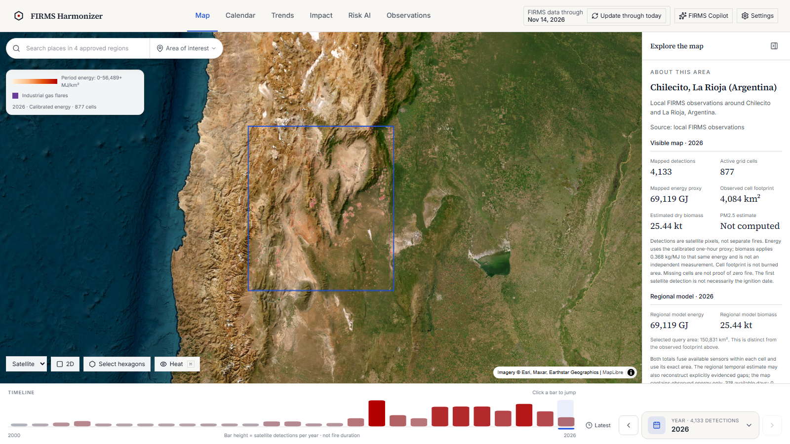

<!-- _paginate: false -->

# Project Almenara

Restaurando 26 años de memoria satelital de incendios de la NASA

26 años de registro continuo · 2000–2026

MODIS2000 · píxel de 1 km

VIIRS2012 · píxel de 375 m

Una serie de incendios comparable entre dos generaciones de satélites: armonizada, auditada y explicada.

▶ <a href="http://localhost:5173/">Abrir la demo en vivo · FIRMS Harmonizer</a>

App en vivo: mapa, calendario, tendencias, impacto, riesgo y FIRMS Copilot sobre el cubo real.

---

## Rigor matemático y método científico

Planteamos una hipótesis falsable, fijamos los umbrales antes de medir y publicamos también los fallos

<b class="n">H₀</b>
<b>Hipótesis.</b> El salto de 2012 es instrumental (resolución de VIIRS), no climático. Si acertamos, la serie armonizada no muestra ruptura estructural en 2012.

* **Umbrales fijados antes de ver resultados:** test de ruptura de Chow p > 0,10 y reducción de Wasserstein-1 ≥ 88 %.
* **Mismo código, cuatro regiones reales:** Chilecito (AR), Iberia (ES/PT), Manaos (BR), Orlando (EE. UU.).
* **Incertidumbre, no conjeturas:** suavizador RTS Kalman con covarianza estabilizada (Joseph) e intervalos del 95 %.
* **Huecos solo con evidencia:** un día sin datos nunca se rellena salvo que una caída de sensor o una máscara de nubes lo justifique.
* **Reproducible:** 720 tests automáticos en el backend y un informe de validación que cualquiera puede volver a ejecutar.

### Los tests detrás del veredicto

$$F_{\text{Chow}}=\frac{\big(\text{RSS}_{p}-(\text{RSS}_1+\text{RSS}_2)\big)/k}{(\text{RSS}_1+\text{RSS}_2)/(N_1+N_2-2k)}$$

$$W_1(F_{\text{pre}},F_{\text{post}})=\int_{-\infty}^{\infty}\lvert F_{\text{pre}}(x)-F_{\text{post}}(x)\rvert\,dx$$

$$P_{t|t}=(1-K h)^2P_{t|t-1}+K^2R$$

Lo que <u>no</u> afirmamos

- Las detecciones son píxeles de satélite, no incendios individuales.
- No reconstruimos sin evidencia explícita de hueco.
- El R² frente a área quemada es descriptivo, no una validación fuera de muestra.
- El PM2.5 solo se muestra cuando existen datos de emisión.

---

## La ilusión del 400 %: resolución frente a realidad

Sin armonización, una década de historia de incendios no es comparable

■ MODIS &nbsp; ■ VIIRS &nbsp; detecciones crudas por año · nuestras 4 regiones · pasa el ratón por una barra

{{CHART}}

{{JUMP}} %

Detecciones crudas de 2011 a 2012: <b>{{T2011}} → {{T2012}}</b>. Los incendios no cambiaron; cambió el sensor.

* Los píxeles de VIIRS miden **375 m**: en un píxel MODIS de 1 km caben unos 7.
* En 2012 VIIRS vio **{{RATIO}}×** más detecciones que MODIS en los mismos lugares y días.
* Contar píxeles a ciegas convierte una mejora del sensor en una falsa tendencia de incendios.

---

## Nuestra solución en cuatro pasos

De puntos dispersos a una serie histórica limpia y comparable · haz clic en un paso para ver su matemática

01

### Malla de hexágonos
Puntos repartidos en un área H3 común.

Cuadratura H3 · huella PSF

Matemática

La PSF elíptica de cada detección se reparte entre su celda H3 r7 (5,16 km²) y sus 6 vecinas: $w_j\propto e^{-\frac12 d_j^\top\Sigma_k^{-1}d_j}$.

02

### Filtrado de ruido
Descarta el calor industrial permanente (antorchas, plantas).

Entropía temporal de Shannon

Matemática

$H_{\text{temp}}=-\frac{1}{\ln 12}\sum_m p_m\ln p_m$. Las fuentes activas todo el año ($H>0{,}75$) son industriales, no incendios estacionales.

03

### Armonización de sensores
Corrige el salto de sensibilidad de VIIRS.

Mapeo cuantílico EQM + cola GPD

Matemática

$\hat X_V=F_M^{-1}(F_V(X_V))+\Delta E_{\text{sub}}$, por bioma y ángulo de escaneo; $\Delta E_{\text{sub}}$ añade la energía que MODIS no ve por debajo de 8 MW, a partir de una cola de Pareto generalizada.

04

### Huecos de muestreo
Estima nubes y caídas de sensor con incertidumbre honesta.

RTS Kalman + IC 95 %

Matemática

Cuando todos los sensores están ciegos, un prior histórico entre sensores ($R=40$) mantiene vivo el estado; las bandas se ensanchan en lugar de inventar datos.

* **Área hexagonal H3 común** → todos los sensores se miden sobre el mismo terreno.
* **Sin calor industrial ni salto de VIIRS** → las tendencias reflejan incendios, no hardware.
* **Los huecos llevan incertidumbre** → el gráfico muestra qué sabemos y con qué precisión.

---

## Auditoría estadística: medida, no prometida

Cubo real, recalculado el 15 nov 2026 · el mismo código que el panel de auditoría de la demo

| Región | p de Chow · cruda → armonizada | Control 2012 | Reducción W₁ |
|---|---|---|---|
| Iberia (ES/PT) | 0,083 → **0,57** | APRUEBA | 86,7 % |
| Chilecito (AR) | 0,034 → **0,31** | APRUEBA | 85,4 % |
| Manaos (BR) | 0,38 → **0,46** | APRUEBA* | 42,6 % |
| Orlando (EE. UU.) | 1,7·10⁻⁷ → **0,005** | NO APRUEBA | 72,2 % |

Cómo leer esta tabla

- p de Chow > 0,10 significa que no hay ruptura estructural en enero de 2012: la serie es continua.
- \*Los datos crudos de Manaos tampoco mostraban ruptura, así que su aprobado no prueba la corrección.
- W₁ mide cuánto difieren las distribuciones antes y después de 2012; ninguna región alcanza aún nuestro objetivo del 88 %.
- La ruptura de Orlando se reduce cinco órdenes de magnitud pero persiste: la mostramos en lugar de ocultarla.

3 / 4

regiones superan el control de continuidad de 2012 tras la armonización

43–87 %

menos divergencia entre épocas (Wasserstein-1)

▶ <a href="http://localhost:5173/">Demo interactiva: FIRMS Harmonizer (2000–2026)</a> &nbsp;·&nbsp; Mapa H3 en vivo · Calendario · Riesgo e impacto · FIRMS Copilot

